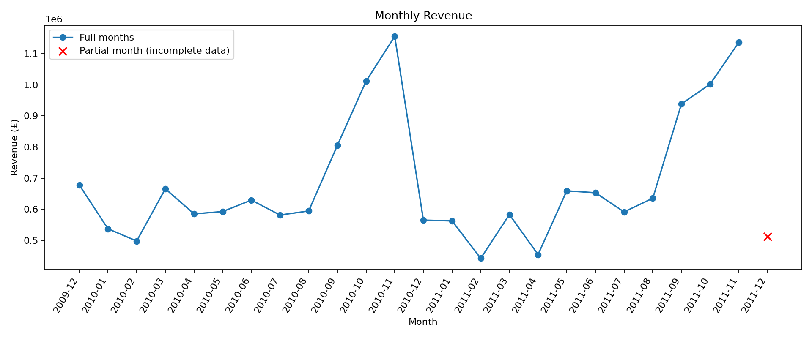
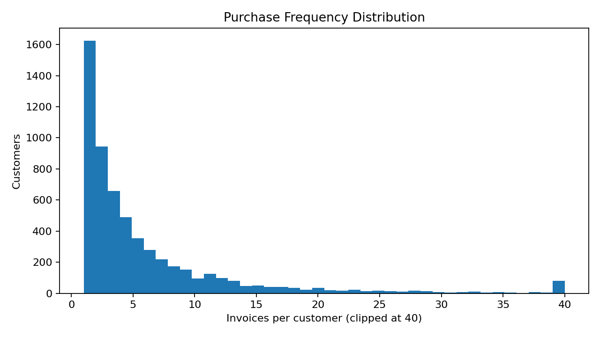
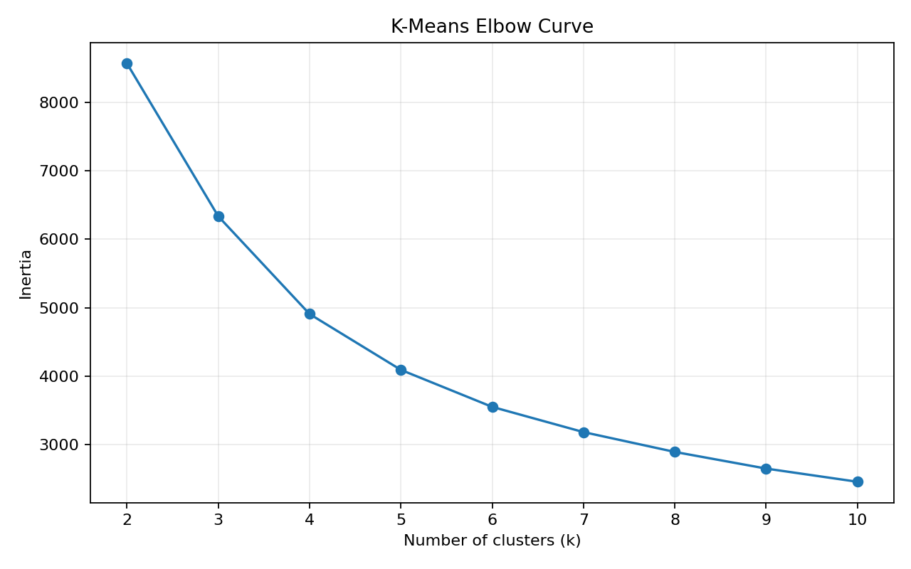
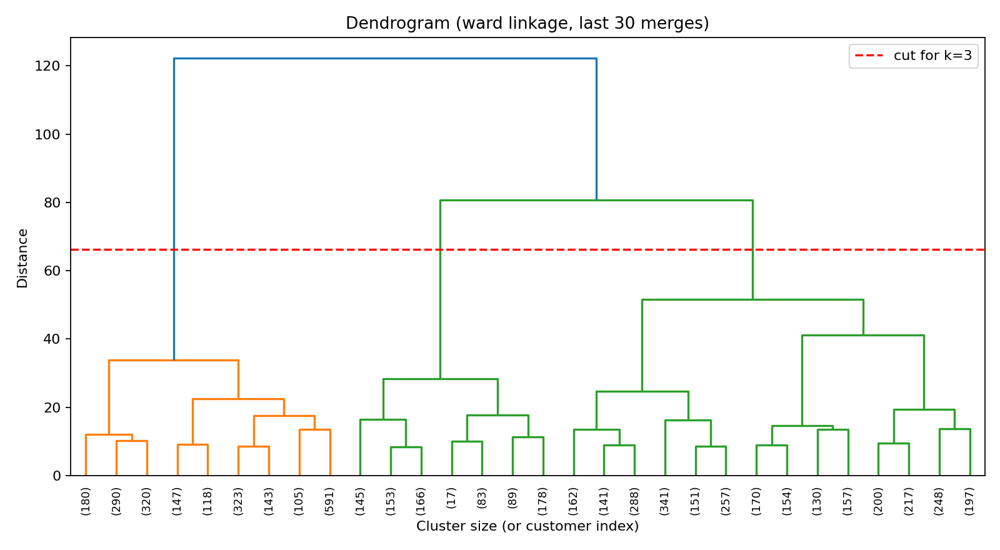
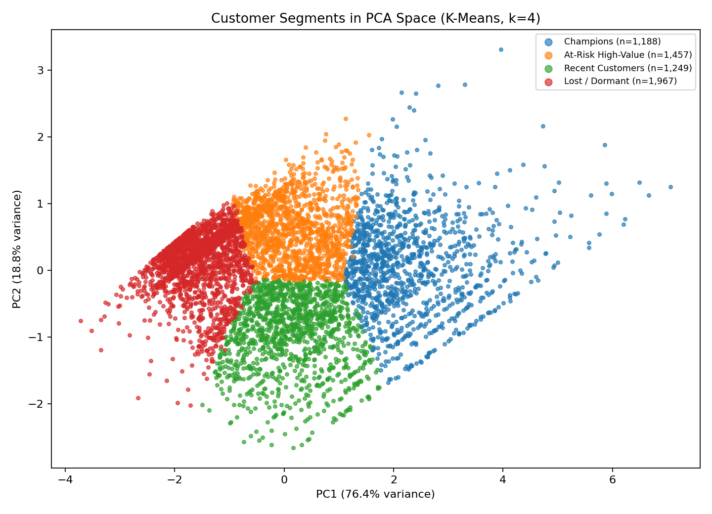
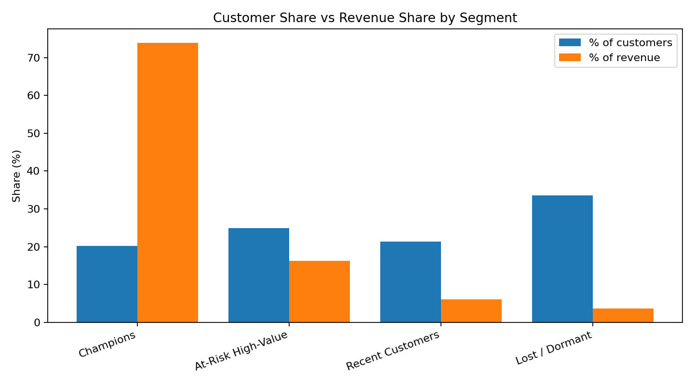
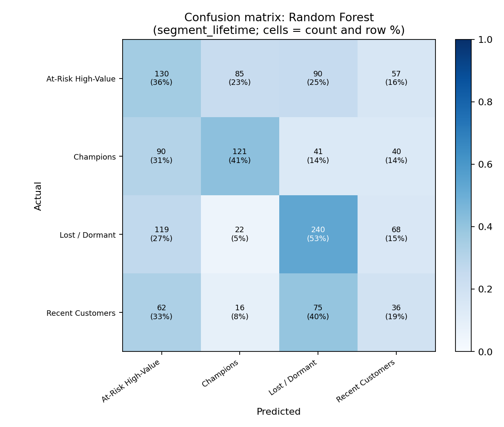
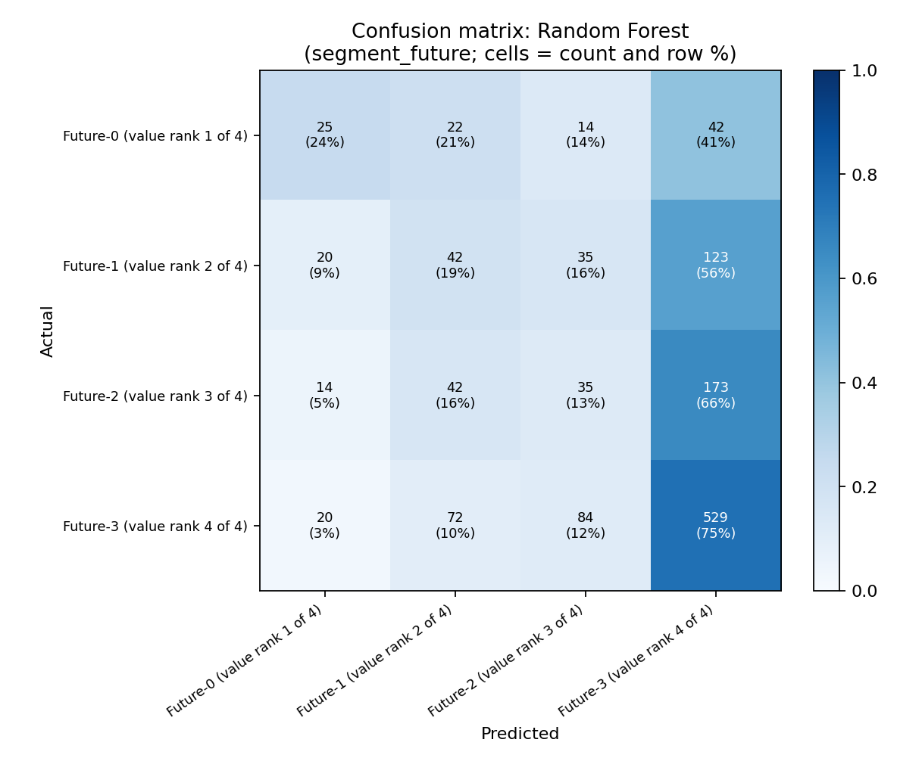

# P07 - Customer Segmentation for an Online Retailer
**Applied Machine Learning (CSAI2017P) - Team Tesseract**

> **DRAFT generated by `src/make_report.py` from `results/`.** Read it, correct the interpretation, and shorten or extend it to 4-6 pages before submission.

## 1. Question and approach
Which distinct customer groups exist in online retail transactions, and can a model assign a new customer to a segment using only early purchase behaviour? We clean the UCI Online Retail II data, build Recency-Frequency-Monetary (RFM) features per customer, compare K-Means, hierarchical clustering and DBSCAN, interpret the segments, and predict segments from a customer's first weeks of activity without leakage.

## 2. Data and cleaning
After cleaning, 776,672 transactions remain from 5,861 customers, 36,669 invoices and 41 countries (2009-12-01 to 2011-12-09).

| rule | rows_before | rows_after | rows_removed | decision |
|---|---|---|---|---|
| exact_duplicates | 1067371 | 1033036 | 34335 | Keep the first copy of exact duplicate rows. |
| missing_customer_id | 1033036 | 797885 | 235151 | Remove rows without Customer ID for customer-level segmentation; report lost share. |
| cancellation_invoices | 797885 | 779495 | 18390 | Baseline excludes cancellation invoices rather than netting them to original invoices. |
| non_product_stock_codes | 779495 | 776735 | 2760 | Exclude known service/adjustment codes; review unique codes during EDA. |
| missing_descriptions | 776735 | 776735 | 0 | Remove rows without a product description. |
| non_positive_quantity | 776735 | 776735 | 0 | Keep positive quantities; cancellation invoices were already excluded. |
| non_positive_price | 776735 | 776672 | 63 | Keep positive unit prices. |

Cancellation invoices (Invoice starting with `C`) are excluded rather than netted against the original purchases, so Monetary is gross retained sales; this is a stated limitation.

## 3. Exploratory analysis
Gross revenue is GBP 17,073,528. Among complete months the peak is 2010-11 (GBP 1,156,008) and the low is 2011-02 (GBP 442,294); partial months (2011-12) are excluded from these statements. The top product by revenue is REGENCY CAKESTAND 3 TIER (GBP 277,656) and the top country is United Kingdom (GBP 14,291,645).

**Purchasing patterns.** 27.7% of customers bought only once; customers placed a median of 3 invoice(s), with a median average invoice value of GBP 277. The top 10% of customers account for 63.9% of revenue. Busiest weekday by revenue: Thursday; busiest hour: 12:00.

*Monthly revenue (partial months marked)*

*Invoices per customer*

## 4. RFM features
Recency is days from 2011-12-10T12:50:00 to the last purchase; Frequency is distinct invoices; Monetary is GBP spent. Raw Frequency and Monetary are strongly right-skewed, so we apply `log1p` and standardise before clustering.

| feature | mean | median | max | skew_raw | skew_log1p |
|---|---|---|---|---|---|
| Recency | 200.817 | 95.000 | 739.000 | 0.892 | -0.487 |
| Frequency | 6.256 | 3.000 | 377.000 | 12.121 | 1.003 |
| Monetary | 2,913.074 | 854.990 | 580,987.040 | 25.342 | 0.266 |

## 5. Clustering
**K-Means, k = 2-10**

| k | inertia | silhouette_full | davies_bouldin | calinski_harabasz | min_cluster_share |
|---|---|---|---|---|---|
| 2 | 8,570.230 | 0.438 | 0.873 | 6,161.557 | 0.395 |
| 3 | 6,335.382 | 0.348 | 1.036 | 5,200.126 | 0.207 |
| 4 | 4,906.956 | 0.365 | 0.931 | 5,043.441 | 0.203 |
| 5 | 4,090.604 | 0.343 | 0.950 | 4,828.887 | 0.078 |
| 6 | 3,549.442 | 0.335 | 0.961 | 4,629.908 | 0.081 |
| 7 | 3,180.898 | 0.301 | 0.983 | 4,417.689 | 0.061 |
| 8 | 2,890.998 | 0.296 | 1.000 | 4,249.365 | 0.061 |
| 9 | 2,647.796 | 0.290 | 1.014 | 4,126.117 | 0.044 |
| 10 | 2,454.886 | 0.289 | 1.012 | 4,006.327 | 0.038 |

*K-Means elbow curve*

**Stability (ARI across 20 subsamples of 80%)**

| k | stability_ari_mean | stability_ari_std |
|---|---|---|
| 2 | 0.987 | 0.010 |
| 3 | 0.952 | 0.023 |
| 4 | 0.972 | 0.033 |
| 5 | 0.920 | 0.052 |
| 6 | 0.895 | 0.046 |
| 7 | 0.805 | 0.143 |
| 8 | 0.829 | 0.115 |
| 9 | 0.862 | 0.055 |
| 10 | 0.901 | 0.111 |

**Hierarchical clustering: best silhouette per linkage**

| linkage | k | silhouette | cophenetic_correlation |
|---|---|---|---|
| average | 2 | 0.517 | 0.717 |
| complete | 2 | 0.399 | 0.595 |
| ward | 2 | 0.355 | 0.536 |

*Ward dendrogram (truncated)*

**DBSCAN.** Best DBSCAN configuration under the stated constraints.
Noise analysis used eps=0.40, min_samples=20 (4.2% noise, 2 clusters).

## 6. Segments and recommendations
Final choice: K-Means with k = 4 (highest silhouette among k in 3..6 with smallest segment >= 5% of customers and stability ARI >= 0.75).

| k | silhouette_full | min_cluster_share | stability_ari_mean | meets_constraints | chosen |
|---|---|---|---|---|---|
| 3 | 0.348 | 0.207 | 0.952 | True | False |
| 4 | 0.365 | 0.203 | 0.972 | True | True |
| 5 | 0.343 | 0.078 | 0.920 | True | False |
| 6 | 0.335 | 0.081 | 0.895 | True | False |

| SegmentName | customers | customer_share | revenue_share | recency_median | frequency_median | monetary_median |
|---|---|---|---|---|---|---|
| Champions | 1188 | 0.203 | 0.739 | 16.500 | 13.000 | 4,904.980 |
| At-Risk High-Value | 1457 | 0.249 | 0.163 | 184.000 | 4.000 | 1,449.140 |
| Recent Customers | 1249 | 0.213 | 0.061 | 24.000 | 3.000 | 716.570 |
| Lost / Dormant | 1967 | 0.336 | 0.036 | 402.000 | 1.000 | 271.700 |

*Segments in PCA space*

*Customer share vs revenue share*

**Recommended actions**

- **Champions** (Most recent, most frequent, highest spend.) - VIP/early-access programme; loyalty rewards; referral incentives; avoid blanket discounts.
- **At-Risk High-Value** (Previously frequent, high spend, but have gone quiet.) - Priority win-back: personal outreach, offers on previously bought categories, feedback survey.
- **Recent Customers** (Bought recently but with few orders so far.) - Onboarding emails, second-purchase incentive, product recommendations to build the habit.
- **Lost / Dormant** (Long inactive with low order count.) - Low-cost reactivation email series; suppress from paid campaigns if no response.

## 7. Predicting segments from early behaviour
Features use only each customer's first 30 days after their first purchase and a 90-day future horizon for the labels (5,167 customers with both windows complete). Lifetime RFM and acquisition date are excluded; scaling is fitted inside pipelines on the training split only. Two label sources are reported: **future** (segments built only from activity in the horizon after the early window; the leakage-free headline) and **lifetime** (the Phase 5 segments; optimistic because the labels include the early window).

| task | model | accuracy | balanced_accuracy | macro_f1 |
|---|---|---|---|---|
| segment_future | Decision Tree | 0.440 | 0.358 | 0.326 |
| segment_future | Logistic Regression | 0.446 | 0.377 | 0.347 |
| segment_future | Majority baseline | 0.546 | 0.250 | 0.177 |
| segment_future | Random Forest | 0.488 | 0.329 | 0.330 |
| segment_lifetime | Decision Tree | 0.396 | 0.368 | 0.375 |
| segment_lifetime | Logistic Regression | 0.411 | 0.397 | 0.394 |
| segment_lifetime | Majority baseline | 0.348 | 0.250 | 0.129 |
| segment_lifetime | Random Forest | 0.408 | 0.375 | 0.378 |

- `segment_lifetime`: 5,167 customers; best model by cross-validated macro-F1: **Random Forest**.
- `segment_future`: 5,167 customers; best model by cross-validated macro-F1: **Random Forest**.

*Confusion matrix (segment_lifetime)*

*Confusion matrix (segment_future)*

**Per-class recall (test)**

| task | model | metric | value |
|---|---|---|---|
| segment_lifetime | Majority baseline | recall[At-Risk High-Value] | 0.000 |
| segment_lifetime | Majority baseline | recall[Champions] | 0.000 |
| segment_lifetime | Majority baseline | recall[Lost / Dormant] | 1.000 |
| segment_lifetime | Majority baseline | recall[Recent Customers] | 0.000 |
| segment_lifetime | Logistic Regression | recall[At-Risk High-Value] | 0.315 |
| segment_lifetime | Logistic Regression | recall[Champions] | 0.476 |
| segment_lifetime | Logistic Regression | recall[Lost / Dormant] | 0.490 |
| segment_lifetime | Logistic Regression | recall[Recent Customers] | 0.307 |
| segment_lifetime | Decision Tree | recall[At-Risk High-Value] | 0.442 |
| segment_lifetime | Decision Tree | recall[Champions] | 0.312 |
| segment_lifetime | Decision Tree | recall[Lost / Dormant] | 0.477 |
| segment_lifetime | Decision Tree | recall[Recent Customers] | 0.243 |
| segment_lifetime | Random Forest | recall[At-Risk High-Value] | 0.359 |
| segment_lifetime | Random Forest | recall[Champions] | 0.414 |
| segment_lifetime | Random Forest | recall[Lost / Dormant] | 0.535 |
| segment_lifetime | Random Forest | recall[Recent Customers] | 0.190 |
| segment_future | Majority baseline | recall[Future-0 (value rank 1 of 4)] | 0.000 |
| segment_future | Majority baseline | recall[Future-1 (value rank 2 of 4)] | 0.000 |
| segment_future | Majority baseline | recall[Future-2 (value rank 3 of 4)] | 0.000 |
| segment_future | Majority baseline | recall[Future-3 (value rank 4 of 4)] | 1.000 |
| segment_future | Logistic Regression | recall[Future-0 (value rank 1 of 4)] | 0.476 |
| segment_future | Logistic Regression | recall[Future-1 (value rank 2 of 4)] | 0.236 |
| segment_future | Logistic Regression | recall[Future-2 (value rank 3 of 4)] | 0.197 |
| segment_future | Logistic Regression | recall[Future-3 (value rank 4 of 4)] | 0.600 |
| segment_future | Decision Tree | recall[Future-0 (value rank 1 of 4)] | 0.447 |
| segment_future | Decision Tree | recall[Future-1 (value rank 2 of 4)] | 0.214 |
| segment_future | Decision Tree | recall[Future-2 (value rank 3 of 4)] | 0.155 |
| segment_future | Decision Tree | recall[Future-3 (value rank 4 of 4)] | 0.616 |
| segment_future | Random Forest | recall[Future-0 (value rank 1 of 4)] | 0.243 |
| segment_future | Random Forest | recall[Future-1 (value rank 2 of 4)] | 0.191 |
| segment_future | Random Forest | recall[Future-2 (value rank 3 of 4)] | 0.133 |
| segment_future | Random Forest | recall[Future-3 (value rank 4 of 4)] | 0.750 |

## 8. Limitations
- Cancellations are excluded, not netted, so Monetary is gross sales and a few reversed orders may inflate individual customers.
- Segment names are heuristic labels from centroid thresholds; the clusters are not ground truth.
- Customers acquired in the last window+horizon days are excluded from the classification task, so very recent customers are not represented.
- A single train/test split on one dataset (UK retailer, 2009-2011) limits how far the results generalise.
- Silhouette scores on RFM data are modest because customer behaviour is continuous rather than sharply clustered.

## 9. Reproducibility
See `REPRODUCIBILITY.md`. Run `python src/run_all.py` from the repository root after placing `data/raw/online_retail_II.xlsx`. All seeds are fixed (`random_state=42`).

## 10. AI and external resources
Claude (Anthropic) was used to help write and test the Phase 2 and Phase 4-7 scripts. All code was reviewed and must be understood by each member. Data: UCI Online Retail II. Libraries: pandas, NumPy, scikit-learn, SciPy, Matplotlib.
